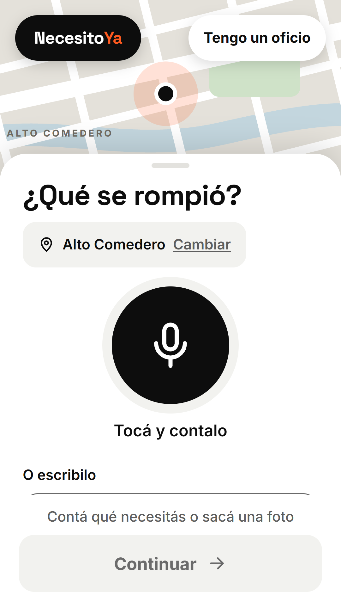
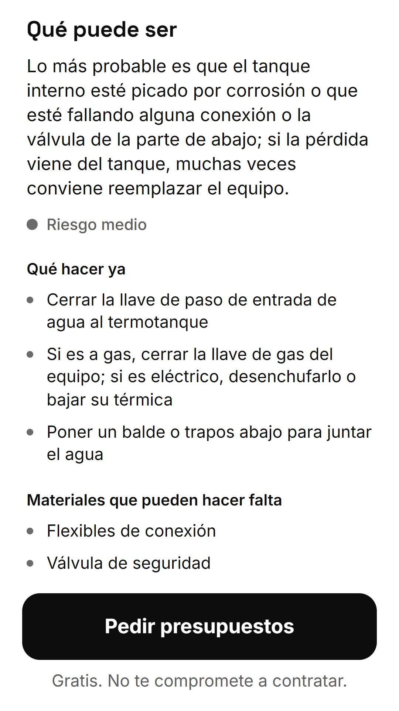
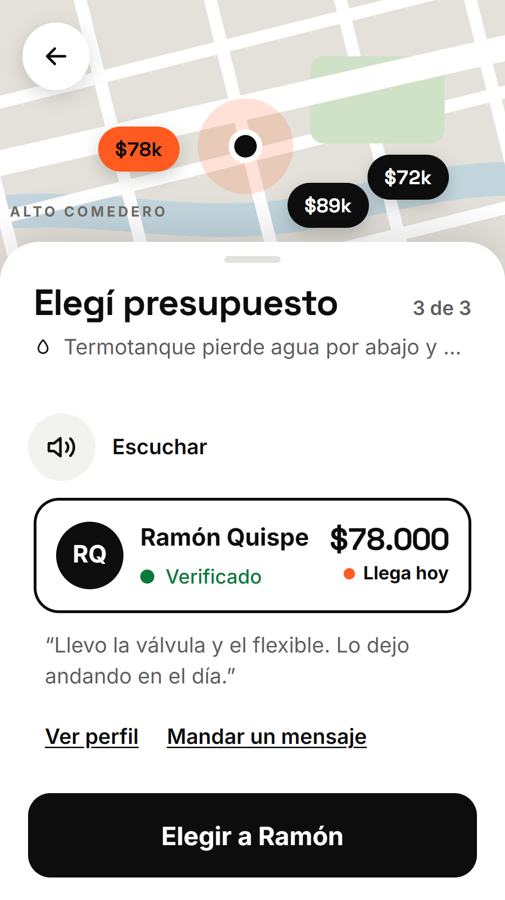
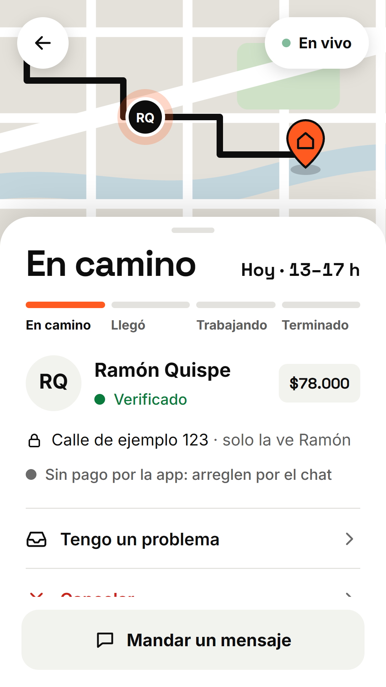
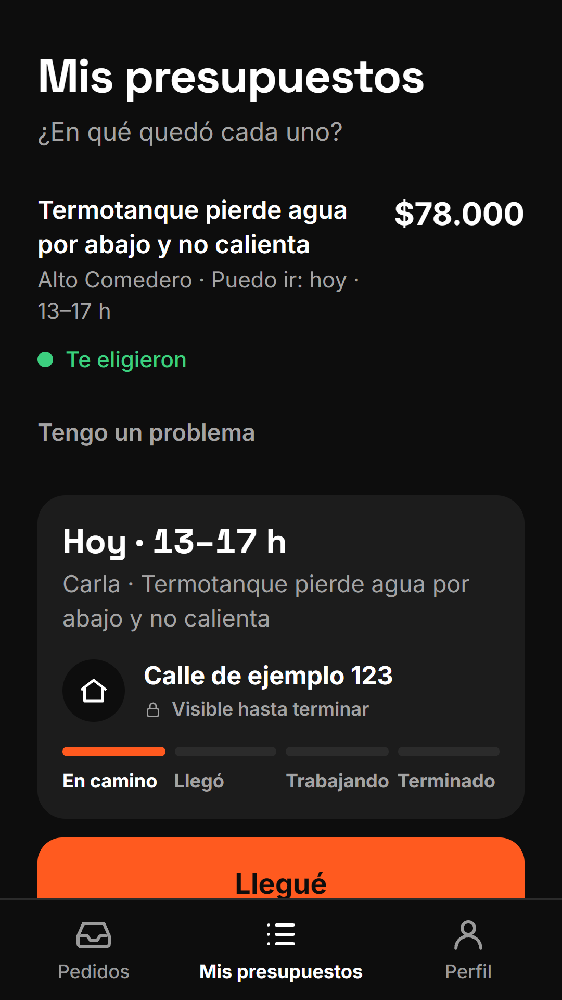
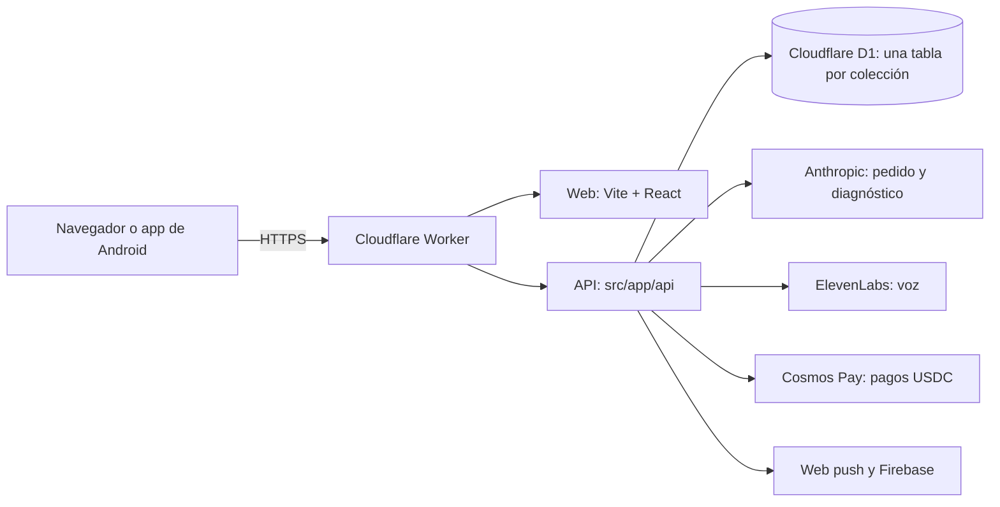

# NecesitoYa

Contás qué se rompió hablando, escribiendo o con una foto, y la app te dice qué puede ser, cuánto suele costar y quién de tu barrio lo arregla. Comparás hasta tres presupuestos, elegís día y seguís el trabajo en vivo, como un viaje en Uber. Hecha para San Salvador de Jujuy y Palpalá en el Cursor Hackathon Jujuy (Tren Solar, noviembre de 2026), por Gabriel y Silvia.

**App publicada:** https://necesitoya.gabriel13iturre.workers.dev. Se abre en el celular o en la compu; en la compu conviene achicar la ventana a tamaño de celular.

<p>
  
  
  
  
  
</p>

> **Los datos que vas a ver son de demostración.** Prestadores, vecinos, pedidos, chats y reseñas son inventados. Están marcados como demostración, no cuentan como uso real y no se mezclan con los pedidos de vecinos reales. Las fotos de trabajos son ilustraciones. Uso real al momento de escribir esto: 1 prestador y 1 pedido.

## Probala en 3 minutos, con las cuentas de demostración

Entrá desde **Cuenta**, en la barra de abajo. No hace falta registrarse:

| Para ver | Mail | Contraseña |
| --- | --- | --- |
| El lado del vecino | `vecina@necesitoya.demo` | `demo2026` |
| El lado del prestador | `prestador@necesitoya.demo` | `demo2026` |

Arriba aparece un cartel naranja "Demo · todo inventado" mientras estés en una de estas cuentas.

**Como vecina (Carla, de Alto Comedero):**

1. En el inicio tocá *Termotanque pierde agua…*. Vas a ver **tres presupuestos** juntos para comparar, con su precio en el mapa: cuándo puede ir, si está verificado y sus reseñas; abajo, el diagnóstico de la IA. Tocá *Ver perfil* o *Mensaje*.
2. Volvé y abrí *Se tapó el inodoro…*. El plomero está **en camino**: el mapa muestra el recorrido, la dirección que solo ve él y el chat.
3. *Salta la térmica…*: la electricista ya está **trabajando**.
4. En **Mis pedidos** abrí *Pintar el living*, un trabajo **terminado y calificado** (con su comprobante), y *Arreglar el revoque*, que tuvo un **reclamo resuelto**. *Pedir de nuevo* arranca un pedido igual.
5. Para probar el flujo desde cero, escribí o dictá un problema en la pantalla de inicio. La IA lo ordena y arma el diagnóstico. Lo que pidas con esta cuenta queda en el barrio de demostración.

**Como prestador (Ramiro, plomero matriculado):**

1. En **Pedidos** están los pedidos del barrio sobre el mapa y en lista, con los lugares que quedan (●●○). Abrí uno y mandá tu precio eligiendo días y franjas.
2. En **Presupuestos**, el trabajo de Carla está *en camino*: abrilo y **deslizá** para avisar *Llegué*, *Empecé* y *Terminé* (con una foto del después). Después entrá como vecina y confirmá que quedó bien.
3. En **Perfil** están sus números (trabajos terminados, cobrados por la app y reseñas) y su ficha pública: verificado con matrícula, fotos de trabajos y reseñas.

## Qué funciona

- **Pedido con voz, texto o foto.** La IA arma un pedido claro y un **diagnóstico orientativo**: lo más probable, el riesgo, qué hacer ya, materiales y preguntas para el prestador. Con gas o electricidad siempre pide un matriculado y da los pasos de seguridad.
- **Hasta tres presupuestos**, con el último lugar guardado 15 minutos para prestadores del barrio. Cada prestador dice si está **verificado**: DNI y, si tiene, matrícula, revisados a mano.
- **Trabajo tipo Uber.** El prestador ofrece días y franjas, y el vecino elige y carga la dirección. La dirección la ve solo el elegido, mientras dura el trabajo, y se borra al terminar. Los estados En camino, Llegó, Trabajando y Terminado se siguen en vivo.
- **Chat dentro de la app.** Nadie ve el teléfono de nadie: los números se tapan en el chat, en los presupuestos, en los pedidos y en los perfiles. Se puede denunciar o bloquear.
- **Cierre con foto y calificación.** Hay un perfil público con historial y reseñas.
- **Reclamos con fotos, cancelación y reprogramación.** Hay un panel interno en `/admin` para verificar, moderar, resolver reclamos y ver métricas de uso real.
- **Cuenta con mail y contraseña o con Google.** Eliminar la cuenta desde la app o en `/eliminar-cuenta`, como pide Google Play.
- **Avisos en el celular:** web push en el navegador y avisos nativos en la app de Android.
- **Voz:** dictado y lectura en voz alta de pedidos y presupuestos.
- **Pago por la app** con Cosmos Pay (USDC en Stellar), con la comisión de NecesitoYa separada en la misma transacción.
- **App de Android** (Capacitor) en la prueba interna de Google Play.

**Lo que todavía no está** (lo decimos tal cual):

- **Pago protegido** (la plata retenida hasta que el vecino confirma): la app está lista para activarlo sola, pero Cosmos todavía no lo publicó en su API. Hoy el pago es directo.
- **Mercado Pago:** el código está hecho, faltan las credenciales de la aplicación ([pasos](docs/mercadopago-pasos.md)).
- **Mails** para recuperar la contraseña y confirmar una baja: el código está hecho, falta configurar el proveedor ([pasos](docs/correo-pasos.md)).
- **Llamadas sin mostrar el número:** falta un proveedor de telefonía.

## Arquitectura



- **Web:** Vite, React 19, React Router 7, Tailwind 4 y TypeScript. Es negro y blanco con un acento naranja; el lado del prestador es oscuro.
- **API:** cada ruta es un `src/app/api/**/route.ts`, registrado en `src/servidor/rutas.ts`, con `Request` y `Response` estándar. En producción corre en un Worker de Cloudflare con D1. En desarrollo la sirve Vite y guarda en un archivo local.
- **Integraciones:** una carpeta por servicio en `src/integraciones/`, cada una con su README. Si falta la clave de un servicio, esa parte se apaga y la app sigue andando.
- **App de Android:** Capacitor abre la versión publicada, así que casi todos los cambios llegan solo con publicar la web. El paquete firmado lo arma GitHub Actions al subir una etiqueta `android-v*`.

## Estructura

```
src/app/            pantallas (page.tsx) y API (api/**/route.ts)
src/components/     piezas de pantalla
src/lib/            reglas de la app: base, pedidos, trabajo, pagos, chat, moderación, demo, métricas
src/integraciones/  anthropic-ia, elevenlabs-voz, cosmos-pagos, mercadopago-pagos, webpush-avisos,
                    firebase-avisos, resend-correo, google-cuenta, capacitor-android
src/servidor/       rutas de la API, cloudflare/ (Worker + D1) y local/ (desarrollo)
pruebas/            tandas de pruebas contra una URL
scripts/            íconos, capturas para Play y correr todas las pruebas
docs/               capturas y pasos de configuración
android/            proyecto de Android (Capacitor)
```

Para cambiar el código, leé [AGENTS.md](AGENTS.md): mapa, comandos y reglas.

## Correrla en tu máquina

```bash
npm ci
cp .env.example .env.local   # completá las claves que tengas; sin claves anda en modo básico
npm run dev                  # http://localhost:3000
```

Para cargar el barrio de demostración en tu base local, entrá a `/admin` con el `ADMIN_SECRET` de tu `.env.local` y abrí la pestaña **Demo**.

## Pruebas

Con la app corriendo:

```bash
node scripts/pruebas.mjs http://localhost:3000
```

Corre las 13 tandas y después borra lo que crearon. Las tandas son:
- `circuito` y `prestador`;
- `muestra`;
- `chat`: además controla que no salga ningún teléfono;
- `cuenta` y `correo`;
- `voz`;
- `confianza`: diagnóstico, verificación, cierre, pagos y webhook;
- `avisos`;
- `moderacion`;
- `turnos`;
- `eliminar`;
- `demo`: el barrio de demostración y su aislamiento.

Las pruebas usan cuentas con mail `.test`: lo que crean no cuenta en las métricas y se borra con `node pruebas/limpiar.mjs <url> --borrar`.

## Publicar

```bash
npx vite build && npx wrangler deploy
```

Las claves van como secretos del Worker (`npx wrangler secret put NOMBRE`), nunca en el repositorio. Las variables de cada servicio están en el README de su carpeta en `src/integraciones/`.
